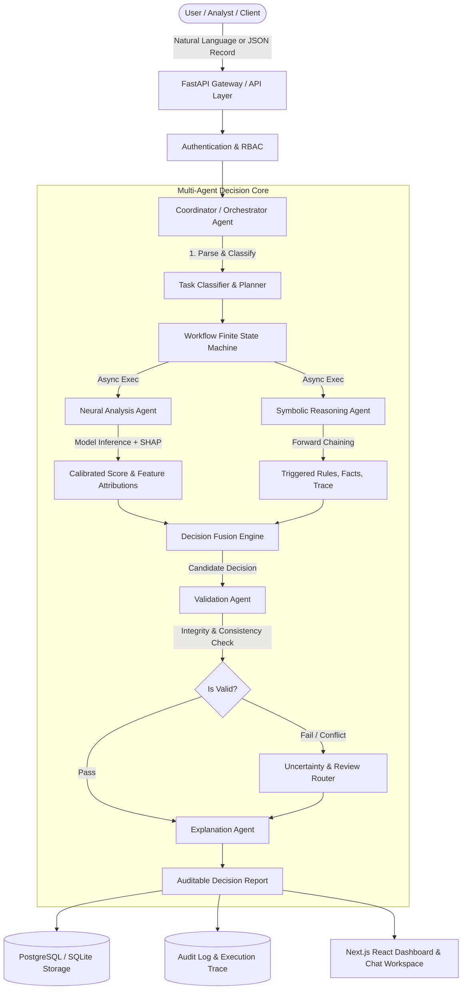

# SYSTEM ARCHITECTURE & TECHNICAL SPECIFICATION

## A Hybrid Symbolic-Neural Framework for Interpretable Decision Support

### 1. High-Level Architectural Diagram

---

### 2. Agent Responsibility Matrix

| Agent Name | Core Paradigm | Inputs | Outputs | Primary Technologies |
| :--- | :--- | :--- | :--- | :--- |
| **Coordinator Agent** | Finite State Machine (FSM) & Routing | Raw Query, JSON Payload, Session Context | Execution Plan, Aggregated Results, Final Payload | Python `asyncio`, Pydantic V2 |
| **Neural Analysis Agent** | Statistical ML & Feature Attribution | Structured numerical & categorical features | Risk probability $[0.0, 1.0]$, SHAP feature contributions, latency | Scikit-learn, LightGBM, SHAP, NumPy |
| **Symbolic Reasoning Agent** | Deterministic Knowledge Base & Rules | Fact dictionary, Transaction state | Triggered rule IDs, conflict flags, deduction trace | Custom Python Forward-Chaining Engine |
| **Decision Fusion Engine** | Multi-Criteria Decision Analysis (MCDA) | Neural score + Symbolic rule triggers | Synthesized decision (`APPROVE`, `FLAG_SUSPICIOUS`, `REJECT`), confidence | Domain Fusion Policy Matrix |
| **Validation Agent** | Invariant & Boundary Verification | Neural output, Symbolic output, Fusion decision | Validation status (`VALID`, `CONFLICT`, `INSUFFICIENT_EVIDENCE`) | Deterministic contract guards |
| **Explanation Agent** | Explainable AI (XAI) Synthesis | Validation report, SHAP values, Rule trace | Human-readable explanation report, feature waterfall | Template Engine + Optional LLM Summarizer |

---

### 3. Workflow State Transitions

The Coordinator enforces explicit, observable workflow states:
1. `RECEIVED`: Request ingested, validated against input schema, correlation ID generated.
2. `CLASSIFIED`: Intent parsed (`CONVERSATIONAL_QUERY` vs `STRUCTURED_DECISION_ANALYSIS`).
3. `PLANNED`: Targeted agents selected and invocation order established.
4. `EXECUTING`: Concurrent dispatch of Neural and Symbolic engines.
5. `FUSING`: Decision fusion policy applied to harmonize probabilistic and logical evidence.
6. `VALIDATING`: Output passed to Validation Agent for constraint verification.
7. `EXPLAINING`: Natural language explanation constructed from verified facts.
8. `COMPLETED` or `REQUIRES_HUMAN_REVIEW`: Final immutable payload committed to audit trail and dispatched to UI.

---

### 4. Decision Fusion Policy Matrix

| Neural Risk Tier | Symbolic Rule Result | Fusion Outcome | Human Review Required | Rationale |
| :--- | :--- | :--- | :--- | :--- |
| **Low Risk** ($< 0.30$) | **No Violations** | `APPROVE` | No | Full consensus: empirical and regulatory clean. |
| **Low Risk** ($< 0.30$) | **Soft Flag** (e.g. Velocity anomaly) | `FLAG_MONITOR` | No | Slight anomaly, model confirms low fraud likelihood. |
| **Low Risk** ($< 0.30$) | **Hard Constraint Violated** (e.g. Sanction list) | `REJECT` (Override) | Yes | **Symbolic Override**: Legal/compliance hard rule supersedes ML probability. |
| **High Risk** ($> 0.70$) | **No Violations** | `FLAG_SUSPICIOUS` | Yes | **Neural Precaution**: Empirical patterns indicate high fraud risk despite lack of explicit rule trigger. |
| **High Risk** ($> 0.70$) | **Hard Constraint Violated** | `REJECT` | No | High-confidence rejection: both neural and symbolic agree. |
| **Medium Risk** ($0.30 - 0.70$) | Any state | `REQUIRES_REVIEW` | Yes | Epistemic uncertainty: borderline confidence demands human oversight. |

---

### 5. Database Schema Architecture

Entity-Relationship entities:
- `users`: User identity, password hash, role (`ANALYST`, `COMPLIANCE_OFFICER`, `ADMIN`).
- `conversations`: Chat sessions for interactive queries.
- `messages`: Natural language user queries and system responses with decision card references.
- `decision_records`: Immutable records of evaluated transactions, inputs, timestamps, latency.
- `agent_executions`: Fine-grained telemetry for each agent run during a decision.
- `symbolic_rules`: Active rules, expressions, categories (HARD, SOFT), versioning.
- `model_registry`: Registered ML models, training metadata, test PR-AUC, calibration params.
- `evaluations`: Baseline vs. Hybrid benchmark runs, precision, recall, F1, PR-AUC, consistency scores.
- `audit_logs`: Tamper-evident operational audit logs with SHA256 integrity signatures.
